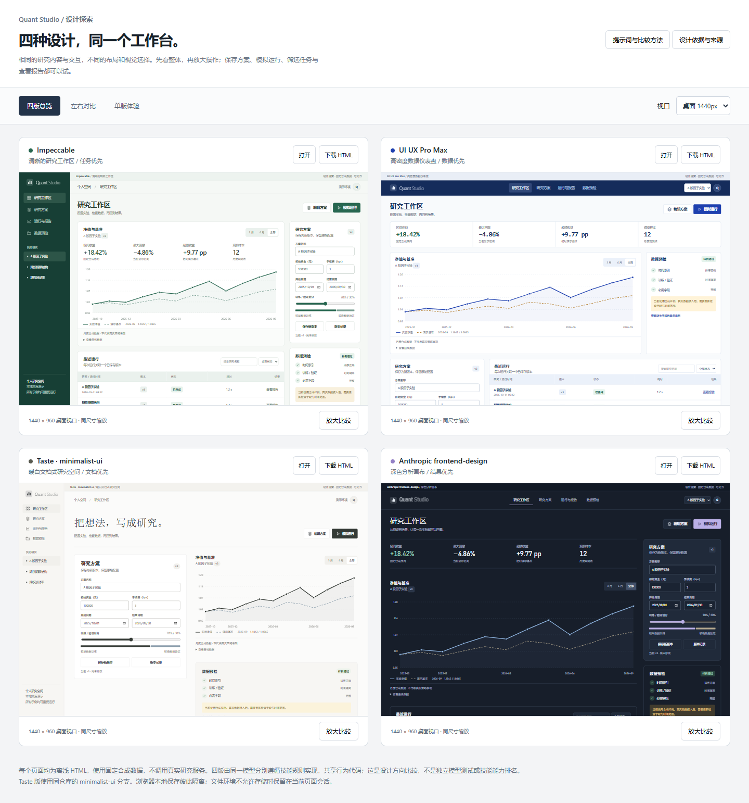

# 工作台 UI 候选模板库（2026-10）

**状态：未来可选方案，四版全部保留，尚未选择正式实现。**

本目录归属 `quant-studio`，供量化仓库群后续工作台改版时讨论和复用。用户喜欢四种方向，希望都保留为候选；本次归档不代表要开发四套生产主题，也不指定某一版为默认界面。

## 查看与比较

下载本目录后，双击 [html/index.html](html/index.html)。它内嵌四版 HTML，支持总览、左右比较、单版体验和手机视口，关闭本地预览服务后也能使用。在 GitHub 中点击 HTML 会看到源码，需要下载后用浏览器打开。

| 候选 | 演示文件 | 主要设计特点 | 将来可参考的页面 |
|---|---|---|---|
| A · Impeccable | [打开 HTML](html/01-impeccable.html) | 左侧导航、任务工作区、结果与配置并列 | 工作台总览、研究操作入口 |
| B · UI UX Pro Max | [打开 HTML](html/02-ui-ux-pro-max.html) | 顶部导航、高密度指标、数据网格 | 实验比较、数据质量与任务监控 |
| C · Taste minimalist-ui | [打开 HTML](html/03-taste-minimalist.html) | 暖白文档、表单优先、克制留白 | 研究方案、笔记和模板编辑 |
| D · Anthropic frontend-design | [打开 HTML](html/04-anthropic-frontend-design.html) | 深色宽图表、结果优先、分析侧栏 | 净值分析、报告阅读与图表工作区 |

表中是候选用途，不是已选定的页面映射。可以选择某一版作为整体方向，也可以在统一导航、组件和交互规则后吸收其他版的局部设计；后续实现应先写明采用范围和取舍。

## 这次保留了什么

- 四份独立 HTML、一个自包含对比页和预览图。
- [共同任务与各版提示词](prompts.txt)、[设计依据](design-decisions.txt)、[固定来源记录](html/sources.json)。
- `build.py` 和 `build_compare.py` 生成源，可在本目录依次运行 `python build.py`、`python build_compare.py` 重建页面。
- [原交互与视口检查](html/checks.json)、[预检异常路径记录](html/preflight-check.txt)、[原审查范围](html/review.txt) 和 [文件哈希](html/SHA256SUMS.txt)。

共同演示流程包括研究表单、不可变版本保存、模拟运行、任务筛选、合成净值曲线、异常预检和报告下载。所有数据都是合成样例；参数编辑只演示配置流程，不计算真实回测收益。四版由同一模型在同一会话分别遵循技能规则制作，复用功能代码，不是技能能力排名。

## 正式采用前的工作

1. 选择一个先改造的真实页面，明确要借用的布局、密度、配色与组件，结合现有信息架构给出效果稿。
2. 将展示组件接到现有 `quant-studio` 页面和真实数据契约；保留不可变方案版本、预检、任务状态、原生产物和失败诊断等行为。Demo 中的固定净值和模拟任务不能接成生产结果。
3. 补齐真实加载、空数据、长名称、运行失败、权限及过期登录状态，验证键盘操作、可读对比度、减少动态效果设置和移动端布局。
4. 按具体变更补充回归测试，并在现有 HTTPS 登录与跨设备访问流程中验收。正式实现、发布或主题切换另开聚焦的功能 PR；本目录的历史记录不替代那次验收。

## 与 agent-toolkit 的分工

通用设计技能及其上游原始规则由 [agent-toolkit PR #4](https://github.com/PureSaber/agent-toolkit/pull/4) 维护；量化工作台的具体模板、产品选型说明和未来采用讨论以本目录及所在的 `quant-studio` PR 为准。

本 PR 只增加文档与独立演示文件，不改变正在运行的工作台、资产页面或服务配置，也不把候选模板计入已交付产品能力。

## 验证与维护边界

原演示已检查文件模式、桌面/手机操作和 375–1440px 横向溢出，详细范围以附带记录为准。本次是原件迁移，HTML 和交互代码按字节保留；只重写归属及后续采用说明。以后修改 HTML 或重新生成页面时，应重新检查交互、更新截图和哈希，不能继续把旧记录当作新版本的验收。
